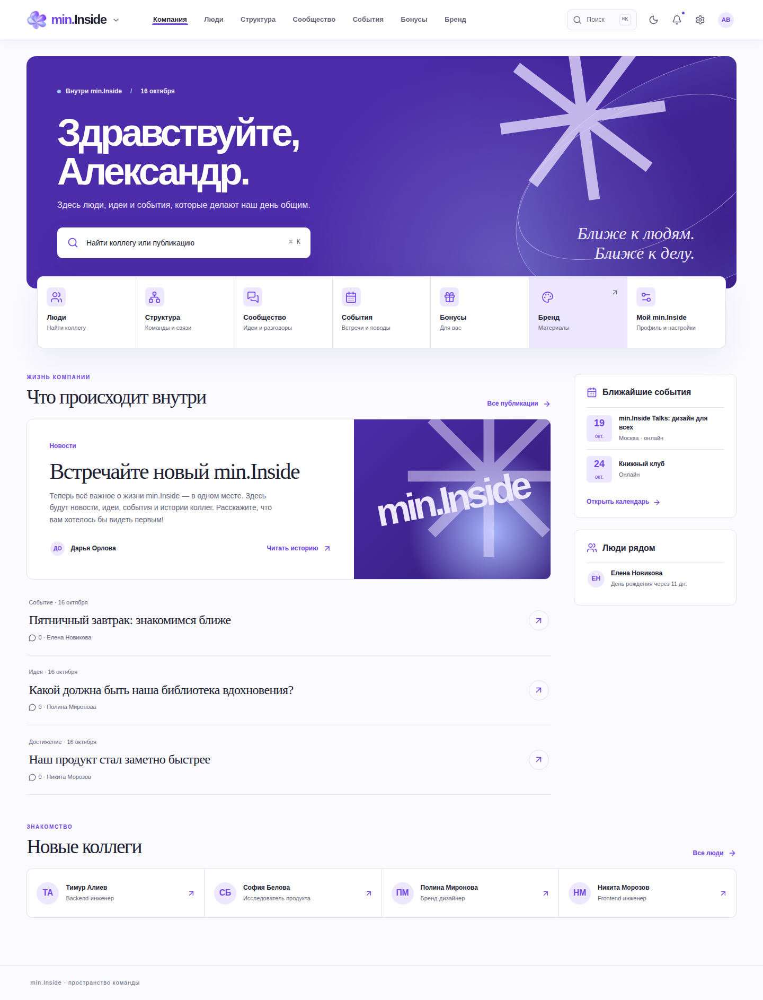

# min.Inside [](https://github.com/minkinad/inside/actions/workflows/ci.yml) [](https://github.com/minkinad/inside/actions/workflows/validate.yml) [](https://github.com/minkinad/inside/actions/workflows/codeql.yml)

min.Inside is a corporate experience portal with fictional local demo content. It is a pnpm monorepo with a Next.js web app, a NestJS REST API, PostgreSQL, Redis, Prisma and MinIO.

## Preview



## Start

Requirements: Node 22+, pnpm 10+, Docker Compose. Copy `.env.example` to `.env`, then run:

```sh
docker compose up -d
pnpm install
pnpm db:generate
pnpm db:migrate
pnpm db:seed
pnpm dev
```

In WSL, use `docker.exe compose up -d` if Docker Desktop exposes `docker.exe` but not `docker`.

Run `pnpm db:seed` only on an empty local database. It refuses populated databases and never deletes existing records. See [local setup](docs/development/setup.md) for configuration and deployment notes.

Open http://localhost:3000. Demo accounts: `alex@min.ex` / `Inside2026!` (employee), `maria@min.ex` / `Inside2026!` (admin). Seed accounts and content are for local development only; seed never runs during build or production startup.

Demo employees start with initials. Each employee can upload their own PNG or JPEG photo in Settings. With MinIO running, the seed also installs two fictional brand materials.

The MVP includes the home feed, employee directory and profiles, career timeline, organization chart, posts with images and comments, celebrations, events, benefits, brand library, and basic administration. Knowledge base, service catalog, saved items and advanced notifications are planned for the next release.

API: http://localhost:4000/api; Swagger: http://localhost:4000/docs. MinIO console: http://localhost:9001.

## Checks

```sh
pnpm lint
pnpm format:check
pnpm validate:repo
pnpm typecheck
pnpm test
pnpm build
pnpm --filter web e2e
```

Docker is needed for integration and E2E checks. Run `pnpm db:migrate` after schema changes; migrations live in `packages/db/prisma/migrations`. The Compose MinIO service uses a pinned Bitnami Legacy MinIO image because the former Docker Hub image is no longer available.

See [architecture and audit](docs/architecture/overview.md), [public-ID migration](docs/architecture/database.md), [existing-data rename](docs/development/rebrand-data.md), [API contracts](docs/api/README.md), [testing](docs/development/testing.md), [design system](docs/design.md), [contributing](CONTRIBUTING.md) and [security policy](SECURITY.md).
